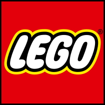

# LEGO

[官网传送门🚪](https://www.lego.com/zh-cn)

[Studio2使用手册](https://studiohelp.bricklink.com/hc/en-us/articles/5626973531287-Step-Editor)

## 介绍

乐高(丹麦语:乐高，港澳常用丹麦文)是一家丹麦的玩具公司，亦指该公司出品的积木玩具，由五彩的塑料积木、齿轮、迷你人型和各种不同其他零件，可组成各种模型物件。乐高作品可以透过多种方式组装和连线，以建造物体，包括车辆、建筑物和工作机器人。任何构造的东西都可以再次拆开，这些碎片可以重复使用来制作新东西。

该公司与多个娱乐公司有合作，如迪士尼、时代华纳。例如在哈利波特和星际大战等电影在美国上映前后，乐高就会推出相应主题玩具。截至2015年7月，乐高已生产 6000 亿个零件。

2015年2月，乐高取代法拉利成为品牌金融(BrandFinance)所评选的“世界上最强大的品牌”。如果将乐高每年生产的轮胎零件也算作轮胎，那么乐高将成为世界上生产最多轮胎的公司。

## 相关网站

[BrickLink]是一个正品乐高产品市场，由来自世界各地的乐高粉丝社区推动。BrickLink拥有所有乐高零件和套装的目录，是寻找丢失的零件、发现稀有和复古套装以及了解用户喜欢或已经拥有的东西的地方。

[rebrickable](https://rebrickable.com)

[BrickLink]: https://www.bricklink.com/v2/main.page

## 单位元件区分

乐高积木按单位元件（studs）可以通过以下几个常见的标准进行区分：

### 1. 尺寸（Size）

乐高积木的尺寸通常以“studs”或“单位元件”来衡量，这是一个基本的乐高度量单位。一个单位元件的大小大约为8毫米。积木的大小可以用“几乘几”来表示，例如2x4表示积木的长度为2个单位元件，宽度为4个单位元件。

### 2. 高度（Height）

乐高积木的高度通常以板块（plates）的厚度为单位。标准的乐高砖块（brick）高度为3块板块（plates）的厚度。常见的高度单位有：

板块（Plate）：高度为1个单位元件的1/3。  
砖块（Brick）：高度为1个单位元件。  

### 3. 类型（Type）

乐高积木的类型种类繁多，以下是一些常见的基本类型：

#### 砖块（Bricks）

  常见的积木，有各种尺寸和颜色，用于结构和基础构建。  

#### 板块（Plates）

  较厚较薄的积木，通常用于细节和层叠。  

#### 瓷砖（Tiles）

表面光滑的积木，用于装饰和完成表面。  

#### 斜坡（Slopes）

斜面的积木，用于创建斜面或屋顶。  

#### 技术零件（Technic Parts）

包括齿轮、轴、连接器等，用于机械和运动结构。

### 4. 连接方式（Connection Methods）

乐高积木通过以下几种方式进行连接：

#### 单位元件连接（Stud Connection）  

  这是最常见的连接方式，积木通过单位元件和底部的空洞连接。

#### 技术零件连接（Technic Connection）  

  使用技术零件中的孔和轴进行连接，通常用于机械结构。  
  
#### 球窝连接（Ball Joint Connection）  

  用于创建可移动的连接，例如机器人和关节。  

### 5. 特殊元件（Special Elements）

除了基本积木外，乐高还包括许多特殊元件，如：

迷你人偶（Minifigures）：小型人偶，用于场景和故事情节。  
植物和动物（Plants and Animals）：各种植物和动物模型。  
装饰件（Decorative Elements）：用于装饰和细节，如窗户、门、标志等。  
配件（Accessories）：用于添加功能和效果的配件，如灯泡、传感器、电机等。
