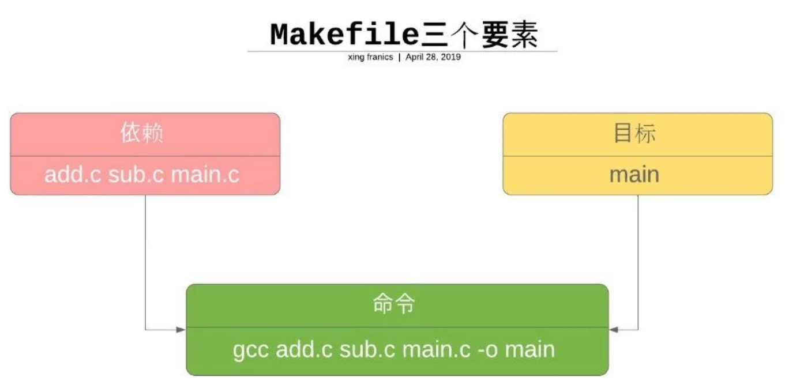
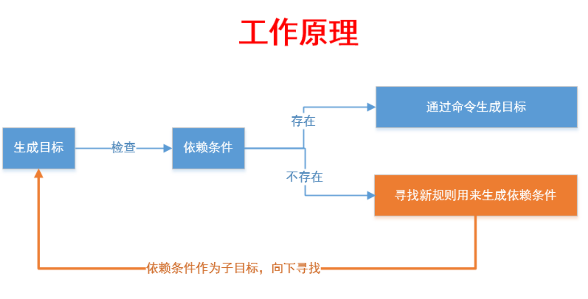
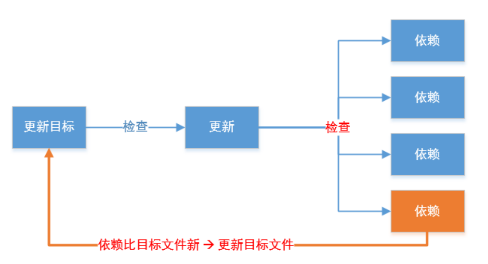
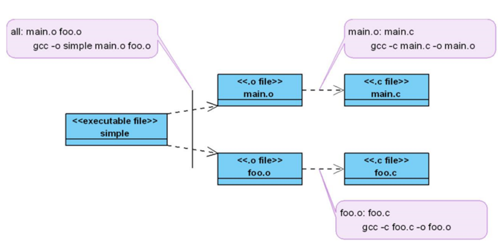
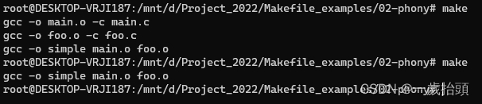
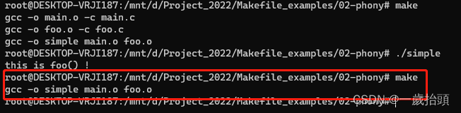
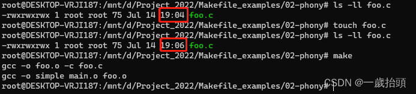

# MakeFile详解

MakeFile是一个强大的工具，用于自动化构建和管理项目  

资料来源：  
[Makefile(1)入门](https://developer.aliyun.com/article/1488371)  
[Makefile(2)原理](https://developer.aliyun.com/article/1488378)  

## 简介

|功能|介绍|
|:--:|:--|
| 编译和构建 | Makefile 可以帮助你定义一键式的编译和构建过程，包括编译不同的目标、链接库、生成可执行文件等。|
| 测试 | 你可以在 Makefile 中定义测试目标，自动运行单元测试、集成测试等，并输出测试结果。 |
| 清理 | Makefile 可以定义清理目标，用于删除生成的临时文件、可执行文件和日志文件等。 |
| 依赖解析 | Makefile 可以根据文件的依赖关系自动确定哪些文件需要重新编译，以提高构建效率。 |
| 部署 | 除了打包和上传，你可以在 Makefile 中定义部署目标，将代码和资源部署到服务器或云平台上。 |
| 生成文档 | 如果你的项目有文档，你可以在 Makefile 中定义生成文档的目标，自动生成 API 文档、用户手册等。 |
| 安装和卸载 | Makefile 可以帮助你定义安装和卸载目标，用于安装程序、服务或库，并进行必要的配置。 |
| 版本管理 | Makefile 可以自动获取版本信息，并将版本号嵌入到程序中。 |
| 环境配置 | 你可以在 Makefile 中定义设置环境变量的目标，以确保构建过程在正确的环境中进行。 |
| 自定义命令 | 除了上述用途，你还可以在 Makefile 中定义自己的自定义命令，以便快速执行一些特定的操作。 |

除了上述用途，你还可以在 Makefile 中定义自己的自定义命令，以便快速执行一些特定的操作。  

总之，Makefile 是一个灵活的工具，可以根据项目的需求实现各种自动化任务。无论是构建、测试、部署还是其他操作，Makefile 都可以帮助你提高效率，简化开发流程。  

Makefile 是一个用于构建和编译程序的工具，它使用规则来描述如何编译和链接源代码文件。  
Makefile 的核心思想是，通过定义一系列规则来描述如何生成目标文件，然后通过执行这些规则来生成目标文件。

想要掌握makefle，首先需要了解两个概念，一个是目标(target)，另一个就是依赖(dependency)。目标就是指要干什么，或说运行 make 后生成什么，而依赖是告诉 make 如何去做以实现目标。在 Makefile 中，目标和依赖是通过规则(rule)来表达的。

  

  

  

## 目标

```MakeFile
all:
    echo "hello world"
```

> 上面Makefile 中的 `all` 就是我们 的目标，目标放在 `:` 的前面，其名字可以是由字母和下划线`_`组成。
> echo "Helo Worid"就是生成目标的命令，这些命令可以是任何你可以在你的环境中运行的命令以及 make 所定义的函数等等。
> `all` 目标的定义，其实是定义了如何生成 `all` 目标，这我们也称之为规则。

```MakeFile
all:
    echo "hello world"
test:
    @echo "test game"
```

顺序运行结果如下：`make all` `make test`

```txt
hello world
test game
```

::: danger 提示
一个 **Makefile** 中可以定义多个目标。调用 make 命令时，我们得告诉它我们的目标是什么，即要它干什么。当没有指明具体的目标是什么 时，那么 make 以 Makefile 文件中定义的第一个目标作为这次运行的目标。这"第一个"目标也称之为默认目标(和是不是all没有关系)。当 make 得到目标后，先找到定义目标的规则，然后运行规则中的命令来达到构建目标的目的。
:::

紧接着对makefle进行如下的改动，在all的后面加上test

```MakeFile
all: // [!code --]
all: test // [!code ++]
    echo "hello world"
test:
    @echo "test game"
```

如上， all 是目标，test是 all 目标的依赖目标，而@echo “Hello World"则是用于生成 all 目标的命令。

运行结果如下：`make all`

```txt
test game
hello world
```

如上图所示text也被构建了

## 依赖

如上面的makefile，all目标后面的 test 是告诉 make，all目标依赖 test 目标，这一依赖目标在Makefile 中又被称之为先决条件。出现这种目标依赖关系时，make工具会按 从左到右的先后顺序先构建规则中所依赖的每一个目标。如果希望构建 all 目标，那么make 会在构建它之 前得先构建 test目标，这就是为什么我们称之为先决条件的原因。

## 规则

**一个规则是由目标(targets)、先决条件(prerequisites)以及命令(commands)所组成的。**

需要指出的是，目标和先决条件之间表达的就是依赖关系(dependency)，这种依赖关系指明在构建目标之前，必须保证先决条件先满足(或构建)。而先决条件可以是其它的目标，当先决条件是目标时，其必须先被构建出来。

::: danger 提示
一个规则中目标可以有多个，当存在多个目标，且这一规则是 Makefile 中的第一个规则时，如果我们运行 make 命令不带任何目标，那么规则中的第一个目标将被视为是缺省目标。
:::

**规则的功能就是指明 make 什么时候以及如何来为我们重新创建目标**，在 Hello Word 例子中，不论我们 在什么时候运行 make 命令(带目标或是不带目标)，其都会在终端上打印出信息来，和我们采用 make 进行代码编译时的表现好象有些不同。当采用 Makefle 来编译程序时，如果两次编译之间没有任何代码 的改动，理论上说来，我们是不希望看到 make 会有什么动作的，只需说“目标是最新的”，而我们的最终 目标也是希望构建出一个“聪明的"Makefile 的。与 Hello Worid 相比不同的是，采用 Makefile 来进行 代码编译时，Makefile 中所存在的先决条件都是具体的程序文件，后面我们会看到。

### 规则语法

``` MakeFile
targets(目标) : prerequisites(依赖)
    command(命令)
```

### makefile的原理

```C
// foo.c
voif foo() {
  printf("this is foo() !\n");
}
```

```C{5}
// main.c
extern void foo();

int main() {
  foo();
  return 0;
}
```

```makefile
all: main.o foo.o 
  gcc -o simple main.o foo.o 
main.o: main.c
  gcc -o main.o -c main.c
foo.o: foo.c
  gcc -o foo.o -c foo.c
clean: rm simple main.o foo.o
```

> 1.目标 all 是默认目标，表示在命令行中只运行 make 时，将执行该目标。  
> 2.它依赖于 main.o 和 foo.o 两个目标。  
> 3.当 main.o 和 foo.o 都已存在，将 main.o 和 foo.o 链接成一个名为 simple 的可执行文件。

上面三段代码生成的依赖树


运行结果：


第二次编译虽未构建目标文件的动作,但却有构建`simple`可执行程序的动作?
我们需要了解 `make` 是如何决定哪些目标(这里是文件)是需要重新编译的。通过文件的时间戳`make`会知道我们是否改变`main.c`和`foo.c`文件内容。

当 `make` 在运行一个规则时，我们前面已经提到了目标和先决条件之间的依赖关系 `make` 在检查一个规则时,采用的方法是：  
**如果先决条件中相关的文件的时间戳大于目标的时间戳，即先决条件中的文件比目标更新，则知道有变化那么需要运行规则当中的命令重新构建目标。**

这条规则会运用到所有与我们在make时指定的目标的依赖树中的每一个规则。比如，对于`simple`项目，其依赖树中包括三个规则，make 会检查所有三个规则当中的`目标(文件)`与`先决条件(文件)`之间的时间先后关系，从而来决定是否要重新创建规则中的目标。

### 问题一：第二次构建的时候为什么simple会被重新构建?

是因为simple文件不存在，我们在这次构建的目标是all，而all在我们编译的过成中并不生成，所以第二次make的时候找不到，所以又重新编译了一遍。

```makefile
all: main.o foo.o // [!code --]
simple: main.o foo.o // [!code ++]
  gcc -o simple main.o foo.o 
main.o: main.c
  gcc -o main.o -c main.c
foo.o: foo.c
  gcc -o foo.o -c foo.c
clean: rm simple main.o foo.o
```

运行结果：


文件的改变不是看文件大小变化，而是文件时间戳的变化。

> `ls -l`命令查看文件时间戳  
> `touch xxx`命令修改文件时间戳  



### 假目标

如果我们的创建了一个clean文件之后，继续去运行make clean，这时候不是按照我们前面运行的make clean进行清理文件。  

因为make将clean当成是一个文件，并且在当前的目录下找到了这个文件，再加上clean目标没有任何的先决条件，这时候进行make clean时，系统会认为clean是最新的。  

使用假目标，假目标最从常用清净就是避免所定义的目标和的已经存在文件是从重名的情况，假⽬标可以采⽤`.PHONY` 关键字来定义，需要注意的是其必须是⼤写字⺟。使用假目标修改makefile。

```makefile
.PHONY: clean  // [!code ++]
simple: main.o foo.o
  gcc -o simple main.o foo.o
main.o: main.c
  gcc -o main.o -c main.c
foo.o: foo.c
  gcc -o foo.o -c foo.c
clean: rm simple main.o foo.o
```

采⽤`.PHONY` 关键字声明⼀个⽬标后，make 并不会将其当作⼀个⽂件来处理，⽽只是当作⼀个概念上的⽬标。对于假⽬标，我们可以想像的是由于并不与⽂件关联，所以每⼀次 make 这个假⽬标时，其所在的规则中的命令都会被执⾏。

>`-j` 或 `--jobs` 选项用于指定同时运行的任务数。
>`-j24` 表示同时运行最多 24 个任务。 例子：make -j24

## 变量

先看代码

```makefile
.PHONY: clean
CC = gcc
RM = rm
EXE = simple
OBJS = main.o foo.o
$(EXE): $(OBJS)
    $(CC) -o $(EXE) $(OBJS)
main.o: main.c
    $(CC) -o main.o -c main.c
foo.o: foo.c
    $(CC) -o foo.o -c foo.c
clean:
    $(RM) $(EXE) $(OBJS)
```

变量的使用可以提高makefile的可维护性。⼀个变量的定义很简单，就是⼀个名字（变量名）后⾯跟上⼀个等号，然后在等号的后⾯放这个变量所期望的值。对于变量的引⽤，则需要采⽤`$(变量名)`或者`${变量名}`这种模式。

在这个 Makefile 中，我们引⼊了 `CC` 和 `RM` 两个变量，⼀个⽤于保存编译器名，⽽另⼀个⽤于指示删除⽂件的命令是什么。还有就是引⼊了 `EXE` 和 `OBJS` 两个变量，⼀个⽤于存放可执⾏⽂件名，可另⼀个则⽤于放置所有的⽬标⽂件名。采⽤变量的话，当我们需要更改编译器时，只需更改变量赋值的地⽅，⾮常⽅便，如果不采⽤变量，那我们得更改每⼀个使⽤编译器的地⽅，很是麻烦。

## 自动变量（☆☆☆☆☆）

对于每⼀个规则，⽬标和先决条件的名字会在规则的命令中多次出现，每⼀次出现都是⼀种麻烦，更为麻烦的是，如果改变了⽬标或是依赖的名，那得在命令中全部跟着改。有没有简化这种更改的⽅法呢？这我们需要⽤到 Makefile 中的⾃动变量，最常用包括：

- **$@⽤于表示⼀个规则中的⽬标。当我们的⼀个规则中有多个⽬标时，$@所指的是其中任何造成命令被运⾏的⽬标。**
- **$^则表示的是规则中的所有先择条件。**
- **$<表示的是规则中的第⼀个先决条件。**

```makefile
.PHONY:all
all:first second third
    @echo "\$$@ = $@"
    @echo "\$$^ = $^"
    @echo "\$$< = $<"
 
first second third:
```

运行结果

```txt
xxxxxx# make
$@ = all
$^ = first second third
$< = first
```

需要注意的是，在 Makefile 中`$`具有特殊的意思，因此，如果想采⽤ echo 输出`$`，则必需⽤两个连着的`$`。还有就是，`$@`对于 Shell 也有特殊的意思，我们需要在`$$@`之前再加⼀个脱字符`\`。

修改simple的makefile

```makefile
.PHONY: clean
CC = gcc
RM = rm
EXE = simple
OBJS = main.o foo.o
$(EXE): $(OBJS)
    $(CC) -o $@ $^
    @echo ">>>> simple:$(CC) -o $@ $^"
main.o: main.c
    $(CC) -o $@ -c $^
    @echo ">>>> main:$(CC) -o $@ -c $^"
foo.o: foo.c
    $(CC) -o $@ -c $^
    @echo ">>>> foo:$(CC) -o $@ -c $^"
clean:
    $(RM) $(EXE) $(OBJS)
    @echo ">>>> clean:$(RM) $(EXE) $(OBJS)"
```

<!-- ## 特殊变量 -->
<!-- TODO： -->
## 语法

### 1.符号

#### 1) 命令前缀

[不用前缀] 输出执行的**命令**以及**命令执行结果**, 出错的话停止执行  
[前缀`@`] 只输出**命令执行结果**, 出错的话停止执行  
[前缀`-`] 命令执行有错的话, 忽略错误, 继续执行  

<!-- #### 2) 通配符

`*` 表示任意一个或多个字符  
`?` 表示任意一个字符  
`[...]` 表示其中任意一个字符  

> `[abcd]` 表示a,b,c,d中任意一个字符  
> `[^abcd]`表示除a,b,c,d以外的字符  
> `[0-9]`表示 0~9中任意一个数字   -->
